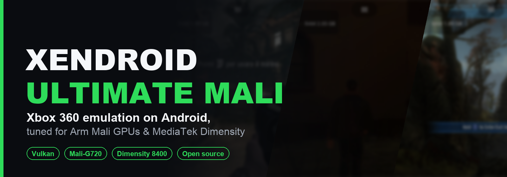
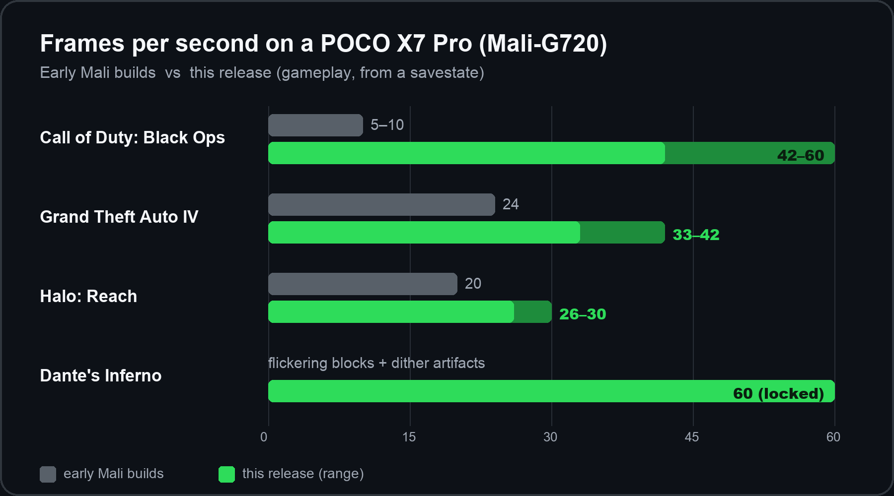
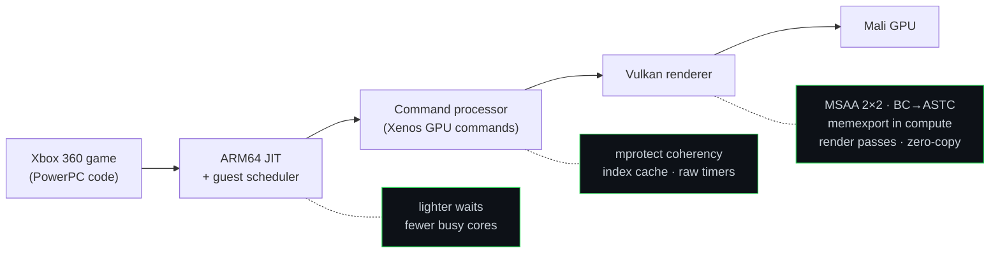

<p align="center">
  
</p>

<p align="center">
  <a href="../../releases/latest"></a>
  <a href="../../releases"></a>
  <a href="../../stargazers"></a>
  <a href="LICENSE"></a>
</p>
<p align="center">
  
  
  
  
  
  
</p>

<h3 align="center">Xbox 360 games, playable on Mali phones.</h3>

<p align="center">
  A performance fork of <a href="https://github.com/rfandango/XenDroid">XenDroid</a> (Xenia on Android).<br>
  Upstream was built for Snapdragon/Adreno: on Mali it ran slowly and drew broken images.<br>
  This fork rebuilds the hot paths for <b>Arm Mali</b> and <b>MediaTek Dimensity</b>, without lowering image quality.
</p>

<p align="center">
  <a href="../../releases/latest"><b>⬇️ Download the APK</b></a>
  &nbsp;·&nbsp; <a href="#-performance">📊 Performance</a>
  &nbsp;·&nbsp; <a href="#-features">✨ Features</a>
  &nbsp;·&nbsp; <a href="#-quick-start">🚀 Quick start</a>
  &nbsp;·&nbsp; <a href="#-faq">❓ FAQ</a>
  &nbsp;·&nbsp; <a href="../../discussions">💬 Discussions</a>
</p>

<br>

<table>
  <tr>
    <td width="33%"></td>
    <td width="33%"></td>
    <td width="33%"></td>
  </tr>
  <tr>
    <td align="center"><b>Call of Duty: Black Ops</b><br><sub>42–60 fps</sub></td>
    <td align="center"><b>Grand Theft Auto IV</b><br><sub>33–42 fps · no black flashing</sub></td>
    <td align="center"><b>Halo: Reach</b><br><sub>26–30 fps · clean image</sub></td>
  </tr>
</table>
<p align="center"><sub>Real in-game screenshots on a POCO X7 Pro, with the built-in overlay (fps, frame time, GPU time, RAM, temperature).</sub></p>

<br>

## 📊 Performance

<p align="center">
  
</p>

<div align="center">

| Game | Early Mali builds | **This release** | What changed |
|:--|:--:|:--:|:--|
| Call of Duty: Black Ops | 5–10 fps | **42–60 fps** | Global guest lock removed; memory coherency rebuilt |
| Grand Theft Auto IV | 24 fps | **33–42 fps** | Fewer 4x transfers; black flashing fixed |
| Halo: Reach | ~20 fps, rainbow artifacts | **26–30 fps** | MSAA 2×2 layout (+30%); rainbow fixed |
| Dante's Inferno | blocks + dither artifacts | **60 fps** (locked) | Mali erratum workaround; dither fixed |
| Need for Speed: Most Wanted | crashed ~40% of boots | **44–51 fps** | Lock-free atomics fixed |

</div>

<sub>Measured on a POCO X7 Pro (Dimensity 8400, Mali-G720), in gameplay, with the guest refresh capped to the game's own vblank. Phones throttle when hot, so the ranges show cool vs warm runs. The MediaTek driver can also cap the GPU clock while charging.</sub>

<br>

## ✨ Features

<table>
  <tr>
    <td width="50%" valign="top">
      <h3>🎨 Correct image on Mali</h3>
      Rainbow particles, flickering blocks, dither patterns and black frames are all fixed. They come from Mali-specific gaps (no BC textures, no <code>vertexPipelineStores</code>, an MSAA quirk, Arm erratum 3786926), and each one has a real fix in the renderer.
    </td>
    <td width="50%" valign="top">
      <h3>⚡ Faster where it matters</h3>
      The heavy work was moved off the slow paths: MSAA 4x as a 2×2 layout, fewer render-pass breaks, zero-copy resolves (−12.6% memory bandwidth per frame), lighter <code>mprotect</code> coherency, and a faster index cache.
    </td>
  </tr>
  <tr>
    <td valign="top">
      <h3>🧊 Cooler and lighter</h3>
      Waits spin less, so fewer CPU cores stay busy for the same fps. Textures are transcoded from BC to ASTC on the GPU, which saves <b>about 280 MB</b> of GPU memory.
    </td>
    <td valign="top">
      <h3>💾 Savestates</h3>
      Save and restore the whole machine in game. It works in Black Ops, Dante's Inferno, Halo: Reach and GTA IV, including live XAM enumerators and files that are still open.
    </td>
  </tr>
  <tr>
    <td valign="top">
      <h3>📱 A modern app</h3>
      New Jetpack Compose interface. It has a game library with a built-in folder browser, so it works even where HyperOS/MIUI block the system picker. Each game has its own settings, each with an explanation.
    </td>
    <td valign="top">
      <h3>🎮 Play comfortably</h3>
      Xbox controller support and an on-screen performance overlay. The interface is in <b>English and Italian</b>, switchable in Settings → Language. Config migration brings new defaults to existing installs.
    </td>
  </tr>
</table>

<br>

## 🚀 Quick start

1. **Download** `xendroid-mali-*.apk` from [Releases](../../releases/latest) and install it (Android 10+, arm64).
2. **Open the app** and pick the folder that holds your games.
3. **Tap a game.** The first launch compiles shaders, so the first minutes can stutter. After that it smooths out.

> [!IMPORTANT]
> This project ships **no games, BIOS, keys or copyrighted content**. Use dumps of games you own.

### Devices

| Status | Hardware |
|:--|:--|
| ✅ **Tested** | POCO X7 Pro: MediaTek Dimensity 8400, Mali-G720 MC7, driver r49p1, Android 16 |
| 🟡 **Should work** | Other recent Mali GPUs (G615, G710, G715, G925) on Dimensity and Exynos, and Adreno 7xx |
| 📝 **Help wanted** | Anything else. [Report your device](../../issues/new/choose): reports from other phones are the most useful contribution right now |

<br>

## 🔬 How it works

Xenia translates Xbox 360 PowerPC code to ARM64 and Xbox 360 GPU commands to Vulkan. On Mali, most of the cost and almost every visual bug sat in the second half of that chain. That half is where this fork does most of its work.



<details>
<summary><b>🎨 GPU: Vulkan on Mali (click to expand)</b></summary>
<br>

- **MSAA 4x stored as a 2×2 1x layout** by default. Resolves read directly from the 2×2 surfaces, with no EDRAM dump. Reach got +30% fps and Dante's dither artifact disappeared.
- **Real render passes instead of dynamic rendering** on Mali drivers older than r52. This works around Arm erratum 3786926, the cause of Dante's flickering blocks.
- **BC/DXT textures transcoded to ASTC** on the GPU, because Mali has no BC support. DXN goes to EAC. This saves about 280 MB of GPU memory.
- **Memexport through compute.** Mali lacks `vertexPipelineStores`, and dropping memexport left rainbow particles in Modern Warfare 2.
- **Fewer pass breaks, less bandwidth.** Clears and alpha-to-coverage stay inside the 2×2 path, and partial resolves copy straight into textures. Reach particle draws are merged, cutting its GPU time by 12%.
- **Zero-copy resolves** are materialized on the GPU in stream order. GPU cycles drop 10.9% and memory bandwidth 12.6% (258 → 225 MB per frame).
- **Hidden GPU faults handled.** The MediaTek driver silently recreates the Vulkan queue after a fatal fault, which shows up as black frames. The signature is documented, a logcat check catches it, and the path that triggered it (bindless textures) is off.

</details>

<details>
<summary><b>🧠 CPU and memory coherency</b></summary>
<br>

- Smarter page-watch/`mprotect` handling between guest memory and GPU caches:
  - finer invalidation blocks (64 → 16 pages, with 30–52% fewer `mprotect` calls);
  - an exclusion bit that is cleared when the CPU writes the page;
  - batched re-protection.
- An **index pre-swap cache** (4-way, 8192 entries) and finer validity epochs (64 KiB).
- Timers read from the raw counter instead of `clock_gettime` on the hot path.
- Atomic reservations (`lwarx`/`stwcx.`) that are safe against ABA. This took Need for Speed: Most Wanted from about 40% crashes to 0 in 14 boots.
- Work on the ARM64 JIT and the guest scheduler. Lighter spin waits keep fewer cores busy for the same fps, which means less heat.

</details>

<details>
<summary><b>💾 Savestates</b></summary>
<br>

Savestates capture the whole machine: guest memory, kernel objects, the GPU state, and files that are still open. They also cover:
- live XAM enumerators (content, achievements, profiles, playlists);
- files deleted while still open;
- partial-page GPU writes;
- modules loaded from DLLs.

Verified in Black Ops, Dante's Inferno, Halo: Reach and GTA IV.

</details>

<br>

## 🗺️ Roadmap

- [x] Correct rendering on Mali-G720 (rainbow, blocks, dither, black frames)
- [x] Black Ops, Dante's Inferno, GTA IV, Halo: Reach and NFS Most Wanted playable
- [x] Savestates
- [x] Bilingual interface (English / Italian)
- [ ] **60 fps** in Black Ops, GTA IV and Reach: needs ≤16.6 ms per frame on both GPU and CPU
- [ ] Keep the depth buffer across color changes (subpasses): Reach's biggest bandwidth lever
- [ ] Find the root cause of the bindless-texture GPU faults on Mali r49p1
- [ ] Test on more Mali and Dimensity devices ([your reports help](../../issues/new/choose))

<br>

## ❓ FAQ

<details>
<summary><b>Will it run on my phone?</b></summary>
<br>
It needs Android 10+ on arm64 with a Vulkan driver. It is tuned on Mali-G720, and other recent Mali GPUs should benefit from the same fixes. Adreno should still work, since the upstream paths are kept, but it is not tested here. Please <a href="../../issues/new/choose">report</a> how it runs on yours.
</details>

<details>
<summary><b>Which games work?</b></summary>
<br>
The five games in the table above are the ones measured in depth. The changes are in the shared core, not per game, so other titles benefit too. Compatibility reports are welcome.
</details>

<details>
<summary><b>Why does the fps drop after a while?</b></summary>
<br>
Heat. Every phone lowers its GPU and CPU clocks when it gets hot, and some drivers also cap the GPU while charging. A cooler or a fan makes a large difference.
</details>

<details>
<summary><b>The first minutes stutter. Is that normal?</b></summary>
<br>
Yes. The first time each game runs, its shaders are compiled. They are cached, so later sessions are smooth.
</details>

<details>
<summary><b>Where do I get games, BIOS or keys?</b></summary>
<br>
Not here. This project contains only the emulator. Dump the games you own.
</details>

<details>
<summary><b>Is this related to Microsoft?</b></summary>
<br>
No. This is an independent open-source project with no affiliation to Microsoft or any game publisher.
</details>

<br>

## 🛠️ Building

Requirements: JDK 21, Android SDK 35, NDK `29.0.14206865` and CMake `3.30.3`. Builds on macOS and Linux are tested. Host setup is described in [`src/xendroid-src/BUILD.md`](src/xendroid-src/BUILD.md).

```bash
export ANDROID_HOME=/path/to/Android/sdk
lab/build.sh
```

The script builds the native core (`libe.so`, the slow part) and packages it with the Compose UI. The result is `lab/build/apk/xendroid-mali.apk`. Set `XD_APP_ID` to use a different Android app id.

<details>
<summary><b>📁 Repository map</b></summary>
<br>

| Path | What it is |
|---|---|
| `src/xendroid-src/` | The emulator: Xenia core in C++ (`emulator-core/src/main/cpp/xenia/`), JNI, third-party libraries |
| `src/xendroid-ui/` | The Android app (Kotlin, Jetpack Compose) |
| `lab/build.sh` | Build script |
| [`docs/LAB-NOTEBOOK.md`](docs/LAB-NOTEBOOK.md) | **Lab notebook**: every experiment and its verdict, failures included |
| `lab/test/` | Phone test harness (`xdtest.py`), flicker/logcat checks, measurement history (900+ runs) |
| `lab/build/analysis/` | Profile, thread and frame-replay analysis scripts |
| [`docs/status/`](docs/status) | Project status, cause maps, plans |
| [`docs/TEST-RULES.md`](docs/TEST-RULES.md) | How tests are run and judged |
| [`research/`](research) | Mali driver r49p1 notes, errata, frame generation, thermal and RAM studies |
| `tools/` | Mali GPU counters (`xd_gpuctr`), perf summaries, pass and bandwidth reports |

The lab scripts were written for one phone and one build machine. Read them as reference, and expect to adapt them before running them elsewhere.

</details>

<details>
<summary><b>📜 History</b></summary>
<br>

| When | Version | Milestone |
|---|---|---|
| Sep 2026 | first Mali builds | XenDroid running on Mali-G720: memexport through compute, BC→ASTC transcoding |
| early Oct 2026 | multi-game core | Black Ops 5–10 → 30–46 fps; lighter waits; in-game savestates |
| mid Oct 2026 | Mali fixes | Render passes on drivers older than r52 (Arm erratum 3786926); faster page watch |
| 24 Oct 2026 | q516 | Zero-copy resolves: −12.6% memory bandwidth |
| 25 Oct 2026 | q575 | MSAA 4x as 2×2 by default: Reach +30%, Dante dither fixed |
| 26 Oct 2026 | q607 | GTA IV savestates; Reach GPU −12%; NFS Most Wanted in the library |
| 29 Oct 2026 | **q636** | GTA IV black flashing fixed; first public release |

More than 600 test builds, each measured on the phone before a change was kept.

</details>

<br>

## ⚠️ Known issues

- **Black Ops:** occasional square artifacts. They are nondeterministic and the cause is unknown.
- **Halo: Reach:** the first frame after loading a savestate can briefly show the old rainbow pattern.
- **Bindless textures** (`vulkan_bindless_textures`) cause GPU faults on Mali r49p1, so they are off.
- **Sustained play:** heat lowers fps over time on any phone.

## 🤝 Contributing

The most useful contributions are **device reports** (phone, SoC, GPU driver, game, fps, screenshots), **compatibility reports** for new games, and focused pull requests. See [CONTRIBUTING.md](CONTRIBUTING.md).

## 🙏 Credits

- [Xenia](https://github.com/xenia-project/xenia): Ben Vanik and contributors
- [Xenia Canary](https://github.com/xenia-canary/xenia-canary) and [Xenia Edge](https://github.com/has207/xenia-edge)
- [XenDroid](https://github.com/rfandango/XenDroid) (Fabxx) and xa360e, the Android port this fork builds on
- Every third-party library in `src/xendroid-src/emulator-core/src/main/cpp/xenia/third_party/`, each under its own license

## 📄 License

Xenia and XenDroid code is under the [BSD 3-Clause license](src/xendroid-src/emulator-core/src/main/cpp/xenia/LICENSE). The changes, scripts and documentation in this fork use the same license (see [LICENSE](LICENSE)). Third-party components keep their own licenses.

<sub>Xbox, Xbox 360 and all game names are trademarks of their respective owners. This project is not affiliated with Microsoft or with any game publisher.</sub>

<p align="center"><br>⭐ <b>If this got a game running on your phone, a star helps other Mali users find it.</b></p>
