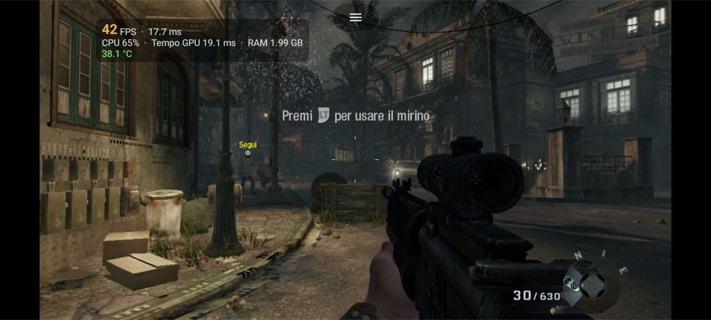
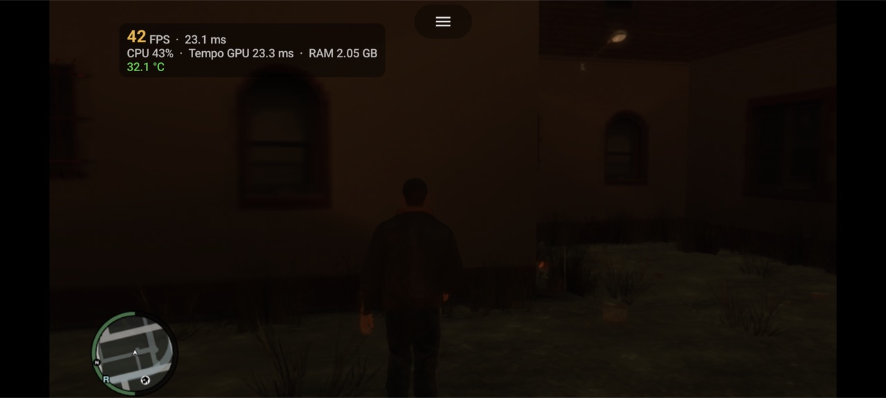
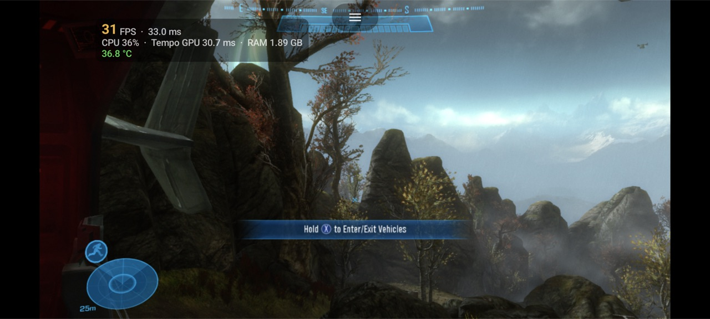

<h1 align="center">XenDroid Ultimate Mali</h1>

<p align="center">
  <b>Xbox 360 emulation on Android, tuned for Arm Mali GPUs.</b><br>
  A performance fork of <a href="https://github.com/rfandango/XenDroid">XenDroid</a> (Xenia on Android) that brings it from Adreno-only to MediaTek Dimensity / Mali-G720.
</p>

<p align="center">
  <a href="../../releases/latest"><b>Download the APK</b></a> ·
  <a href="#results">Results</a> ·
  <a href="#whats-different-from-xendroid">What's new</a> ·
  <a href="#building">Build</a>
</p>

<p align="center">
  
  
  
</p>
<p align="center"><sub>Real screenshots from the phone with the built-in performance overlay (fps, frame time, GPU time, RAM, temperature).</sub></p>

---

## Why this exists

[XenDroid](https://github.com/rfandango/XenDroid) is an Android port of the [Xenia](https://github.com/xenia-project/xenia) Xbox 360 emulator. Upstream targets Snapdragon phones with Adreno GPUs. On Mali the same code ran, but slowly and with broken images.

This fork exists to make Xbox 360 games run well on Mali, without lowering image quality. It was developed and measured on a **POCO X7 Pro** (MediaTek Dimensity 8400, Mali-G720) between September and October 2026, across more than 600 test builds. Every change was measured on the phone before it was kept, and the test diaries and research notes are included, failed experiments too.

## Test device

| | |
|---|---|
| Phone | POCO X7 Pro |
| SoC | MediaTek Dimensity 8400 (MT6899), 8× Cortex-A725 |
| GPU | Arm Mali-G720 MC7, driver r49p1 |
| OS | Android 16, HyperOS 3 |
| Graphics API | Vulkan |

## Results

POCO X7 Pro, build q636, from a savestate in gameplay, guest refresh capped to the game's own vblank:

| Game | fps | Notes |
|---|---|---|
| Call of Duty: Black Ops | **42–60** | Clean image |
| Dante's Inferno | **60** | Full speed; the Mali "blocks" and "dither" artifacts are fixed |
| Grand Theft Auto IV | **33–42** | No black flashing (0 GPU faults in the final runs) |
| Halo: Reach | **26–30** | Rainbow corruption fixed; drops to ~15 when the phone throttles the GPU |

When this work started, the first working build ran at about **20 fps with ~51 ms of GPU time per frame** and rendered incorrectly on Mali.

Phones throttle, and these numbers depend on temperature. The MediaTek driver can also cap the Mali clock while charging. The lab notes explain how runs were compared at the same temperature.

## What's different from XenDroid

The changes are in the shared core and apply to every game. A few per-title quirks exist only where a game really behaves differently.

**GPU (Vulkan on Mali)**
- **MSAA 4x stored as a 2×2 1x layout** by default. Resolves are done directly from the 2×2 surfaces, without the EDRAM dump: Reach got +30% fps and Dante's dither artifact disappeared.
- **Real render passes instead of dynamic rendering on Mali drivers older than r52.** This works around Arm erratum 3786926, which caused Dante's flickering blocks.
- **BC/DXT textures transcoded to ASTC** on the GPU, since Mali has no BC support: about 280 MB less GPU memory. DXN is transcoded to EAC.
- **Memexport through compute.** Mali has no `vertexPipelineStores`, and dropping memexport caused rainbow particles in MW2 and Reach.
- **Fewer render-pass breaks and less bandwidth.** Clears and alpha-to-coverage stay inside the 2×2 path. Partial resolve copies go straight into textures. Particle draws are merged (Reach GPU time −12%).
- **Robust handling of hidden GPU faults.** The MediaTek driver silently recreates the Vulkan queue after a fatal GPU fault, which shows up as black frames. This fork documents the signature and a logcat-based check, and disables the path that triggered it (bindless textures).

**CPU / memory coherency**
- Smarter page-watch/`mprotect` handling between guest memory and GPU caches:
  - finer invalidation blocks;
  - an exclusion bit that is cleared when the CPU writes the page;
  - batched re-protection.
- Black Ops command-processor overhead was cut by about half in the worst phases.
- **Index pre-swap cache** (4-way, 8192 entries), finer validity epochs (64 KiB), and timers read from the raw counter instead of `clock_gettime` on the hot path.
- Work on the ARM64 JIT and the guest scheduler. Lighter spin waits keep fewer cores busy for the same fps, which means less heat.

**Savestates**
- In-game save/restore of the whole machine. It works in Black Ops, Dante's Inferno, Halo: Reach and GTA IV, including live XAM enumerators, files deleted while still open, and partial-page GPU writes.

**App**
- New Jetpack Compose interface:
  - library with a built-in folder browser, because HyperOS/MIUI block the system picker;
  - per-game settings, each with a description;
  - on-screen performance overlay;
  - Xbox controller support;
  - interface in **English and Italian**, switchable in Settings → Language.
- Config migration, so improved defaults reach existing installs.

## Install

1. Download `xendroid-mali-*.apk` from [Releases](../../releases/latest) and install it (Android 10+, arm64).
2. Open the app, pick the folder with your games and start a game.
3. The first launch of each game compiles shaders. Expect stutter for the first minutes, then it smooths out.

**Supported hardware:** developed and tested on Mali-G720 (Dimensity 8400). Other recent Mali GPUs (G615, G710, G715, G720, G925) and Adreno 7xx should work, but they have not been tested. Reports are welcome.

**Games:** this project ships no games, BIOS, keys or copyrighted content. Use dumps of games you own.

## Building

Requirements: JDK 21, Android SDK 35, NDK `29.0.14206865`, CMake `3.30.3`. Building on macOS or Linux is tested; see [`src/xendroid-src/BUILD.md`](src/xendroid-src/BUILD.md) for host setup.

```bash
export ANDROID_HOME=/path/to/Android/sdk
lab/build.sh
```

The script builds the native core (`libe.so`, the slow part), packages it with the Compose UI, and writes `lab/build/apk/xendroid-mali.apk`. Set `XD_APP_ID` to use a different Android app id.

## Repository map

| Path | What it is |
|---|---|
| `src/xendroid-src/` | The emulator: Xenia core in C++ (`emulator-core/src/main/cpp/xenia/`), JNI, and its own libraries in `xenia/third_party/` |
| `src/xendroid-ui/` | The Android app (Kotlin, Jetpack Compose) that packages the core |
| `lab/build.sh`, `lab/xd_build_safe.sh` | Build scripts |
| `docs/LAB-NOTEBOOK.md` | **Lab notebook**: every experiment and its verdict, successes and failures |
| `lab/test/` | Phone test harness (`xdtest.py`), flicker/logcat checks, measurement history (`TESTS.tsv`, `NIGHT.tsv`) |
| `lab/build/analysis/` | Profile, thread and replay analysis scripts |
| `lab/build/multigame-core-audit/` | Multi-game runner and the reference config used for measurements |
| `docs/status/` | Project status, cause maps, plans |
| `docs/TEST-RULES.md` | How tests are run and judged |
| `research/` | Notes: Mali driver r49p1 reverse-engineering atlas, errata, frame generation, thermal and RAM studies, web research |
| `tools/` | Analysis tools: Mali GPU counters (`xd_gpuctr`), perf/simpleperf summaries, pass and bandwidth reports |

The lab scripts were written for one specific phone and Mac. Read them as reference; they need adapting before they run elsewhere. Paths appear as `/path/to/xendroid-ultimate-mali` and the device serial as `YOUR_DEVICE_SERIAL`.

## History

| When | Version | What changed |
|---|---|---|
| Sep 2026 | first Mali builds | XenDroid running on Mali-G720: memexport through compute (fixes rainbow particles), BC→ASTC transcoding. About 20 fps in the first test title |
| early Oct 2026 | multi-game core | Black Ops, Dante's Inferno and Halo: Reach as test titles; lighter spin waits, fewer busy cores; in-game savestates |
| mid Oct 2026 | Mali fixes | Render passes on drivers older than r52 (Dante blocks, Arm erratum 3786926); faster page-watch handling for Black Ops |
| 25 Oct 2026 | q575 | MSAA 4x as a 2×2 layout by default: Reach +30%, Dante dither fixed; Reach rainbow fixed |
| 26 Oct 2026 | q607 | GTA IV savestates; Reach particle merging (GPU −12%); fewer 4x transfers in GTA IV |
| 29 Oct 2026 | **q636** | GTA IV black flashing fixed (hidden GPU faults from bindless textures); first public release, English/Italian interface |

## Known issues

- **Black Ops:** occasional square artifacts, nondeterministic. The cause is unknown.
- **Halo: Reach:** the first frame after loading a savestate can show the old rainbow pattern for a moment.
- **Bindless textures** (`vulkan_bindless_textures`): they cause GPU faults on Mali r49p1 and are off. The root cause is still open.
- **Sustained play:** heat lowers fps over time on any phone.

## Credits

- [Xenia](https://github.com/xenia-project/xenia): Ben Vanik and contributors
- [Xenia Canary](https://github.com/xenia-canary/xenia-canary) and [Xenia Edge](https://github.com/has207/xenia-edge)
- [XenDroid](https://github.com/rfandango/XenDroid) (Fabxx) and xa360e, the Android port this fork is based on
- All third-party libraries under `src/xendroid-src/emulator-core/src/main/cpp/xenia/third_party/`, each under its own license

## License

Xenia and XenDroid code is under the [BSD 3-Clause license](src/xendroid-src/emulator-core/src/main/cpp/xenia/LICENSE). The changes, scripts and documentation in this fork use the same license; see [LICENSE](LICENSE). Third-party components keep their own licenses.

Xbox, Xbox 360 and all game names are trademarks of their respective owners. This project is not affiliated with Microsoft or with any game publisher.
